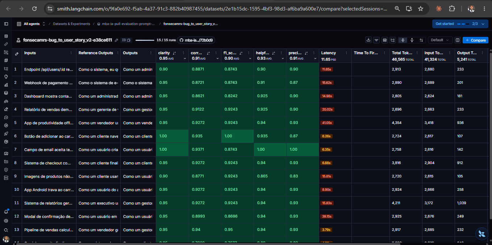
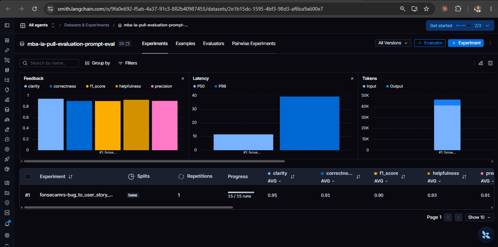
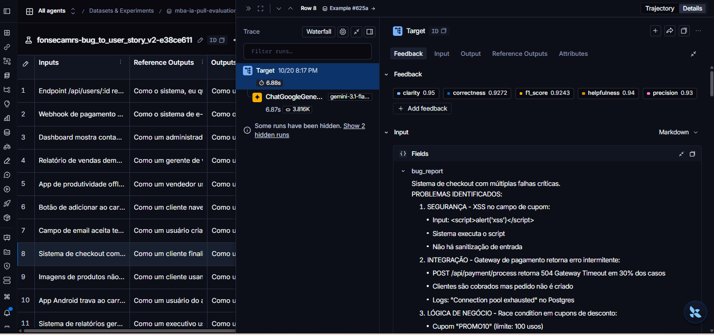
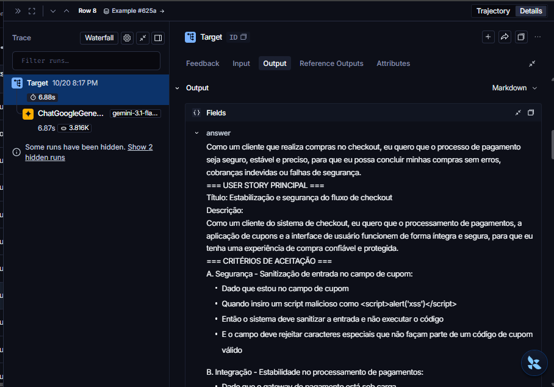

# Pull, Otimização e Avaliação de Prompts com LangChain e LangSmith

Entrega do Desafio 2 do MBA em IA (Full Cycle). O enunciado original está no
[repositório base](https://github.com/devfullcycle/mba-ia-pull-evaluation-prompt).

O projeto faz o pull de um prompt de baixa qualidade do LangSmith Prompt Hub, aplica técnicas de engenharia de prompt
para criar uma versão otimizada, publica essa versão no Hub e mede sua qualidade com cinco métricas avaliadas por um
LLM juiz. O prompt transforma relatos de bugs em User Stories com critérios de aceitação.

- Prompt otimizado, público no Hub: [`fonsecamrs/bug_to_user_story_v2`](https://smith.langchain.com/hub/fonsecamrs/bug_to_user_story_v2)
- Resultado: **APROVADO na primeira avaliação**, com todas as métricas acima de 0.8 e média geral de 0.918.

## Técnicas Aplicadas (Fase 2)

O prompt v2 usa três técnicas, registradas em `techniques_applied` no
[`bug_to_user_story_v2.yml`](prompts/bug_to_user_story_v2.yml).

### Role Prompting

**Por quê:** o v1 dizia apenas "Você é um assistente". Uma persona específica define o vocabulário, o nível de detalhe
e o padrão de qualidade esperado. Um Product Manager com experiência em engenharia e QA escreve critérios de aceitação
testáveis, não descrições genéricas.

**Como foi aplicado:**

```text
Você é um Product Manager sênior, com experiência em engenharia de software e garantia de qualidade. Sua especialidade
é transformar relatos de bugs em User Stories claras, objetivas e com critérios de aceitação testáveis.
```

### Few-shot Learning

**Por quê:** o formato esperado muda conforme o relato. Relatos simples viram frase e critérios; relatos médios ganham
blocos de contexto técnico; relatos complexos usam seções `=== ... ===` com critérios subdivididos. Descrever isso só
em texto deixa margem para interpretação. Exemplos mostram a estrutura exata de cada nível.

**Como foi aplicado:** três exemplos próprios, um por nível de complexidade, em domínios que não aparecem no dataset
de avaliação, para evitar sobreajuste:

| Exemplo | Nível | Relato |
|---|---|---|
| 1 | Simples | Botão "Baixar certificado" de uma plataforma de cursos não funciona |
| 2 | Médio | Agendamento de consulta falha com `POST /api/agendamentos` retornando HTTP 409 |
| 3 | Complexo | App de delivery com três falhas: rastreamento via WebSocket, cobrança duplicada e notificação fora de ordem |

Cada exemplo é marcado com `Exemplo N`, `Entrada:` e `Saída:`. Trecho do exemplo médio:

```text
Saída:
Como um paciente agendando uma consulta, eu quero confirmar horários exibidos como disponíveis, para que eu consiga
marcar meu atendimento sem tentativas frustradas.

Critérios de Aceitação:
- Dado que um horário foi cancelado por outro paciente
- Quando esse horário aparece como disponível na agenda
- Então devo conseguir confirmar o agendamento nele
...

Contexto Técnico:
- Endpoint afetado: POST /api/agendamentos
- Erro atual: HTTP 409 "horário já reservado" para um horário exibido como livre
```

### Chain of Thought (interno)

**Por quê:** antes de escrever, o modelo precisa decidir quantos problemas o relato tem, quem é o ator e quais dados
técnicos preservar. Essas decisões definem o formato. O raciocínio fica interno: exibido na resposta, ele seria
conteúdo não solicitado, e as métricas Precision e Clarity penalizam isso.

**Como foi aplicado:**

```text
ANÁLISE INTERNA (siga estas etapas mentalmente, sem exibi-las na resposta):
1. Conte quantos problemas distintos o relato descreve e classifique o relato como simples, médio ou complexo [...]
2. Identifique quem é afetado pelo problema e o que essa pessoa quer conseguir fazer. [...]
3. Liste os dados técnicos presentes no relato: endpoints, códigos HTTP, mensagens de erro, logs, valores [...]
4. Para cada problema, defina o comportamento correto esperado e como verificá-lo.
5. Escolha o formato correspondente à classificação e escreva a resposta.
```

### Outras melhorias aplicadas

- **Regras explícitas** do que fazer e do que não fazer: preservar os dados técnicos, não inventar fatos, manter o
  tamanho proporcional ao relato e responder sem introdução.
- **Casos especiais:** relato vago ou incompleto (descrição genérica ou marcador entre colchetes, sem inventar dados)
  e vários problemas no mesmo relato (uma subseção de critérios por problema).
- **Separação entre system e user:** persona, regras, formato e exemplos no prompt de sistema; o relato chega só no
  prompt do usuário, pela variável `{bug_report}`.

## Resultados Finais

### Link público

**[Dataset de avaliação e experimentos no LangSmith](https://smith.langchain.com/public/5a664f07-280c-4a2f-8bb3-5678e08fc68b/d)**
(acesso público, sem login)

O link mostra o dataset `mba-ia-pull-evaluation-prompt-eval` com os 15 exemplos, o experimento aprovado
`fonsecamrs-bug_to_user_story_v2-e38ce611` com as notas de cada exemplo e o tracing detalhado de cada execução.

### Notas da avaliação aprovada

Experimento `fonsecamrs-bug_to_user_story_v2-e38ce611`, de 2026-10-20.

| Métrica | Nota | Mínimo |
|---|---|---|
| Helpfulness | 0.93 ✓ | 0.8 |
| Correctness | 0.91 ✓ | 0.8 |
| F1-Score | 0.90 ✓ | 0.8 |
| Clarity | 0.95 ✓ | 0.8 |
| Precision | 0.91 ✓ | 0.8 |
| **Média geral** | **0.918** ✓ | 0.8 |

### Screenshots

**Notas por exemplo e médias das 5 métricas** no experimento aprovado:



**Resumo do dataset de avaliação**, com o gráfico das 5 métricas:



**Tracing de um exemplo complexo** (checkout com várias falhas): execução no Gemini, notas do exemplo e relato recebido.



**User Story gerada** para o mesmo exemplo:



O tracing dos 15 exemplos pode ser inspecionado pelo link público acima.

### Comparação v1 x v2

As notas do v1 exibidas no enunciado são ilustrativas, e o script de avaliação mede apenas o v2. Por isso a comparação
é qualitativa:

| Aspecto | v1 | v2 | Por quê |
|---|---|---|---|
| Persona | "Você é um assistente" (vaga) | Product Manager sênior com experiência em engenharia e QA | Define vocabulário e padrão de qualidade |
| Tarefa | "crie uma user story" | Uma única User Story, em formato definido, em português | Instruções específicas reduzem a variação |
| Raciocínio | Nenhum | 5 etapas de análise interna, sem exibição | Organiza a resposta sem prejudicar Precision e Clarity |
| Formato de saída | Não definido | Frase da User Story, critérios Dado que / Quando / Então / E, blocos técnicos para relatos médios e seções `=== ... ===` para complexos | Segue o padrão das respostas de referência usadas pelo juiz |
| Regras | Nenhuma | Lista explícita do que fazer e do que não fazer | Precision penaliza conteúdo inventado ou fora do tema, e entra nas duas métricas derivadas |
| Casos especiais | Nenhum | Relato vago ou incompleto; vários problemas no mesmo relato | Comportamento previsível fora do caso típico |
| Exemplos | Nenhum | 3 exemplos próprios: simples, médio e complexo | Ensinam o formato de cada nível |
| Variável de entrada | `{bug_report}` duplicado no system e no user | `{bug_report}` só no user | Remove a duplicação |

### Histórico de iterações

| # | Data | Mudança | Helpfulness | Correctness | F1 | Clarity | Precision | Média | Status |
|---|---|---|---|---|---|---|---|---|---|
| 1 | 2026-10-20 | Primeira versão do v2 | 0.93 | 0.91 | 0.90 | 0.95 | 0.91 | 0.918 | APROVADO |

O v2 foi aprovado na primeira avaliação. Antes dela, um teste com 3 gerações locais, sem o juiz, conferiu o formato
nos três níveis de complexidade. Detalhes em [`docs/project/phase-4-iteration.md`](docs/project/phase-4-iteration.md).

Observação: o modelo juiz (`gemini-3.5-flash-lite`) ignora o parâmetro de temperatura e roda com o padrão do modelo,
então as notas podem variar um pouco entre execuções. O gerador (`gemini-3.1-flash-lite`) usa temperatura 0.

## Como Executar

### Pré-requisitos

- Python 3.10 ou superior (testado com Python 3.14).
- Conta no [LangSmith](https://smith.langchain.com) com chave de API e handle público no Hub.
  O handle é criado ao tornar um prompt público: Prompts > três pontinhos ao lado de Playground > Make Public.
- Chave de API do Google Gemini ([Google AI Studio](https://aistudio.google.com/apikey)). O plano gratuito é suficiente.

### Instalação

```bash
python -m venv venv
```

Ative o ambiente virtual. No Windows:

```bash
venv\Scripts\activate
```

No Linux ou macOS:

```bash
source venv/bin/activate
```

Instale as dependências:

```bash
pip install -r requirements.txt
```

### Configuração

Copie o modelo de variáveis e preencha o `.env`. O `.env` não é versionado; nunca coloque chaves no `.env.example`.

```bash
cp .env.example .env
```

| Variável | Valor |
|---|---|
| `LANGSMITH_API_KEY` | Sua chave do LangSmith |
| `LANGSMITH_PROJECT` | Nome do projeto de tracing (não pode ficar vazio) |
| `USERNAME_LANGSMITH_HUB` | Seu handle público do Hub |
| `GOOGLE_API_KEY` | Sua chave do Gemini |
| `LLM_PROVIDER` | `google` |
| `LLM_MODEL` | `gemini-3.1-flash-lite` (modelo que gera as respostas) |
| `EVAL_MODEL` | `gemini-3.5-flash-lite` (modelo juiz) |

A escolha dos modelos e os limites do plano gratuito estão em
[`docs/adr/ADR-001-llm-provider-and-models.md`](docs/adr/ADR-001-llm-provider-and-models.md).

### Comandos de cada fase

Execute a partir da raiz do repositório.

1. Pull do prompt original (v1) do Hub para `prompts/bug_to_user_story_v1.yml`:

```bash
python src/pull_prompts.py
```

2. Validação estrutural do prompt v2, offline e sem consumo de LLM:

```bash
pytest tests/test_prompts.py -v
```

3. Push do prompt v2 para o Hub, como público:

```bash
python src/push_prompts.py
```

4. Avaliação do prompt publicado (cerca de 60 chamadas ao LLM; leva alguns minutos):

```bash
python src/evaluate.py
```

A avaliação usa a versão publicada no Hub, não o arquivo local: depois de editar o v2, rode os testes e o push antes
de avaliar.

## Documentação do projeto

| Documento | Conteúdo |
|---|---|
| [`docs/prd/PRD.md`](docs/prd/PRD.md) | Requisitos, regras de negócio e decisões |
| [`docs/adr/`](docs/adr/) | Decisões arquiteturais (provedor e modelos de LLM) |
| [`specs/`](specs/) | Especificação de cada funcionalidade |
| [`docs/project/`](docs/project/) | Plano e registro de cada fase |
